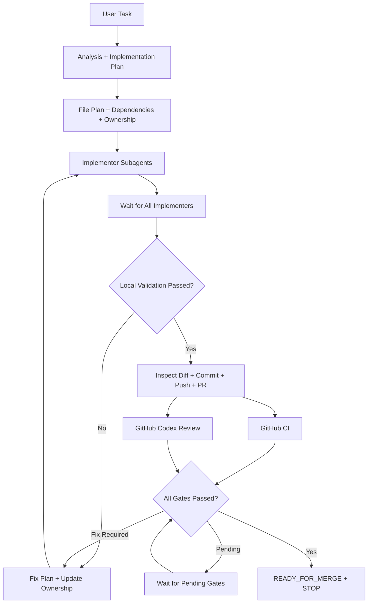

# Codex Multi-Agent Workflow

## TimeCue integration

编码任务必须遵循本流程，先阅读 [贡献规范](../docs/CONTRIBUTING.md)、根目录及相关模块的 `AGENTS.md`。
纯文档任务按请求范围执行；用户明确限制交付范围时如实报告实际状态，不虚报 `READY_FOR_MERGE`。

- 日常开发分支从 `dev` 创建，PR 目标为 `dev`。
- 数据库表结构改动须先获得用户明确请求。
- HTTP 接口新增、删除或更新后，先在 Apifox 创建测试并通过，再继续前端开发。
- 按变更选择贡献规范中的相关验证；未运行或未完成的 CI / Review 不得标为通过。

## Workflow

## 1. Main Agent

The Main Agent MUST:

- Inspect the repository and understand the request.
- Plan implementation, file changes, task dependencies and ownership.
- Delegate implementation, coordinate fixes and run combined validation.
- Inspect the final diff, commit, push, and create or update the PR.
- Monitor CI and inspect GitHub Codex review comments independently.
- Stop when all merge-ready gates pass; never merge the PR.

The Main Agent MUST NOT directly implement or fix production code.

## 2. File Plan

Before creating subagents, list every expected file change with:

| Field | Required content |
|---|---|
| Path | Repository-relative file path |
| Action | CREATE / MODIFY / DELETE / RENAME |
| Purpose | Why the change is needed |
| Contents | Expected contents or changes |
| Owner | Assigned implementation task |
| Dependencies | Tasks that must complete first |

Update the File Plan before assigning any additional writable file.

## 3. File Ownership

- Each writable file may have only ONE active implementer.
- Two active implementers MUST NOT edit the same file.
- Tasks sharing a writable file MUST run sequentially.
- The first owner must complete and release ownership before the next starts.
- A shared writable file therefore creates a task dependency.

## 4. Implementation Tasks

Each task MUST specify its objective, writable files, readable files,
dependencies, expected implementation and validation commands.

## 5. Implementer Rules

Implementation MUST be delegated to `implementer` agents. Each implementer:

- Modifies only assigned writable files; may read other files for context.
- Does not modify unrelated files, expand scope or create subagents.
- Preserves existing architecture and conventions; avoids unrelated refactors.
- Runs relevant validation when practical and never merges PRs.
- Reports any additional required file and its reason instead of editing it.
- Reports incomplete or incompatible dependencies instead of rewriting another agent's files.
- Reports COMPLETE / BLOCKED, changed/created files, implementation,
  validation results, additional files required and remaining issues.

## 6. Parallel Execution

Tasks may run in parallel ONLY when all dependencies are complete
AND their writable file sets do not overlap.

## 7. Implementation Barrier

Before combined validation, ALL three counts MUST be zero:

- Running implementers.
- Pending implementation tasks.
- Active file owners.

## 8. Local Validation

The Main Agent runs relevant combined tests, builds, lint, static analysis
and type checks according to the actual changes and repository instructions.

On failure: create a Fix Plan, update the File Plan and ownership, delegate
fixes, wait for the implementation barrier, then validate again.
The Main Agent MUST NOT directly edit implementation code to fix failures.

## 9. Pull Request

After local validation passes: inspect the final diff, commit, push,
then create or update the PR.
The description summarizes the requested change, implementation,
important files and validation performed.

## 10. CI and GitHub Codex Review

- CI and Codex Review run independently; process either without waiting for the other.
- Required CI checks MUST pass; inspect Codex findings in PR comments.
- CI implementation failures or actionable review findings require a Fix Plan,
  updated File Plan and ownership, implementer fixes and local validation.
- Push validated fixes, then require CI and Codex Review for the updated code.
- Old review results MUST NOT count as approval after new code is pushed.
- Pending checks or review mean wait; unresolved findings mean fix.

## 11. Ready For Merge

Report `STATUS = READY_FOR_MERGE` ONLY when ALL gates pass:

- Implementation complete; no running implementers, pending tasks or active owners.
- Local validation passed; all changes pushed; PR exists.
- Required CI passed for the current PR revision.
- GitHub Codex review completed for the current PR revision.
- No unresolved actionable Codex comments or known merge blockers remain.

The Main Agent MUST stop here.

## 12. Never Merge

The Main Agent MUST NOT run `gh pr merge`, enable auto-merge,
bypass branch protection, force merge or use administrator merge privileges.

## 13. Final Response

Report the summary, changed files, validation, branch, commit, PR number / URL,
CI result, Codex review result and actual status.
When every gate passes, report `READY_FOR_MERGE` and state:

`The PR is ready to merge, but has not been merged.`
