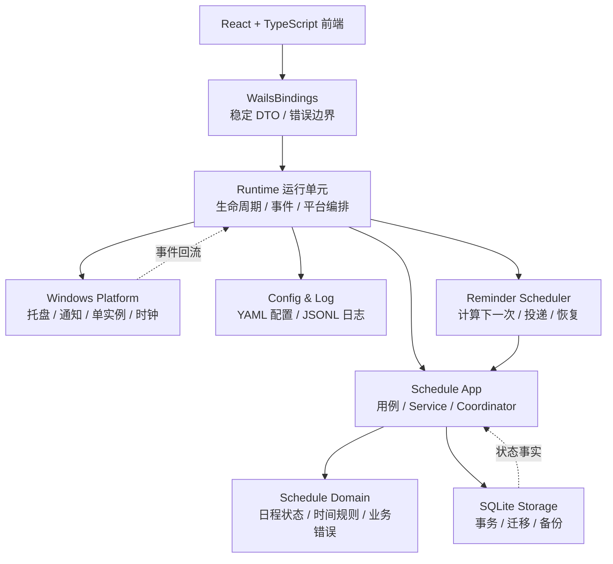

# TimeCue

TimeCue 是一款面向 Windows 的桌面日程提醒应用。它把一次性事项和重复事项统一成可持久化的日程，并通过系统通知、托盘和待处理提醒页面帮助用户完成闭环。

## 功能

- 创建、查看、删除日程，支持标题、备注、开始时间和结束时间。
- 支持四种日程类型：单次、每天、每周和每月。
- 重复日程支持可选截止日期；短月没有对应日期时自动使用当月最后一天。
- 取消或恢复重复日程的后续提醒，保留日程本身和历史事实。
- 待处理提醒列表、提醒详情和逐条确认；打开通知或查看详情不会自动确认。
- 四套主题：奶油桃、薄荷绿、晴空蓝和薰衣草紫，并同步原生窗口标题栏颜色。

## 技术栈

- Go 1.27：启动生命周期、领域规则、应用服务、调度和持久化。
- Wails 2：将 Go 桌面能力与前端页面连接起来。
- React + TypeScript + Vite：桌面界面和交互状态管理。
- SQLite：本地日程、提醒和迁移状态持久化。
- Windows API：单实例、消息线程、系统托盘、Toast 通知、窗口主题和环境时钟。

当前产品目标平台为 Windows。项目包含部分跨平台 stub，主要用于编译隔离和单元测试；完整桌面能力仍依赖 Windows。

## 架构设计

架构以“状态只能通过正式转换改变”为核心规则：前端只通过应用边界发起操作，调度器和应用服务负责业务转换，SQLite 负责提交事实，通知等外部副作用的结果再回流到运行状态。



### 分层职责

| 层 | 目录 | 职责 |
| --- | --- | --- |
| 入口与生命周期 | `main.go`、`internal/bootstrap` | 加载配置、取得单实例资格、初始化资源、运行应用并按逆序清理。 |
| 运行单元 | `internal/runtime` | 组装唯一的 Service、协调器和调度器，管理桌面生命周期、Wails 绑定与运行事件。 |
| 应用层 | `internal/schedule/app` | 提供用例、端口契约、DTO、游标查询、并发保护、提醒处理和调度协调。 |
| 领域层 | `internal/schedule/domain` | 定义日程、重复规则、发生实例、时间边界、状态转换和业务错误。 |
| 时间环境 | `internal/schedule/clock` | 把当前时间和时区环境作为可替换依赖提供给应用层。 |
| 持久化 | `internal/storage/sqlite` | 实现应用层 Store 端口，负责 SQLite 事务、迁移、约束和迁移备份。 |
| 平台适配 | `internal/platform` | 以窄接口接入 Windows 消息线程、托盘、通知、单实例和窗口主题。 |
| 配置与日志 | `internal/config`、`internal/log` | 解析 YAML、解析路径、原子保存配置，并创建结构化 JSONL 日志器。 |
| 页面 | `frontend/src` | 通过受控端口读取状态和提交操作，不直接访问 SQLite、配置文件或平台 API。 |

模块依赖始终从外围指向更稳定的规则：领域层不依赖数据库和 UI，应用层依赖领域契约，存储和平台实现通过端口接入，`bootstrap` 保有顶层资源所有权。重要的外部结果必须回流为可观察状态，避免通知显示、数据库事实和页面状态互相脱节。

## 数据与配置路径

配置基线内嵌于 [`internal/config/defaults.yaml`](internal/config/defaults.yaml)。启动时，程序读取 `timecue.exe` 所在目录的 `config.yaml` 覆盖默认值；配置保存采用原子替换，并保留未知字段。

```yaml
log:
  level: info
  path: ./logs/timecue.log

backup:
  dir: ./backups

window:
  close_behavior: tray

theme: peach
```

支持的值：

- `log.level`：`debug`、`info`、`warn`、`error`。
- `window.close_behavior`：`tray` 或 `exit`。
- `theme`：`peach`、`mint`、`sky` 或 `lavender`。
- `log.path` 和 `backup.dir`：可以使用相对路径或绝对路径；相对路径以 `timecue.exe` 所在目录为基准。

数据文件位置固定为：

```text
%LOCALAPPDATA%\TimeCue\timecue.db
```

数据库路径不能通过 `data_dir` 或其他配置项修改。日志和备份目录可以在设置页中调整，但保存后需要重启才会影响当前进程使用的路径；程序不会在运行中迁移或删除旧目录中的文件。

### 迁移备份与恢复

仅当检测到需要迁移时，程序才会在关闭数据库连接后创建备份，文件名格式为：

```text
timecue.db.<UTC 时间戳>.bak
```

备份失败不会执行迁移；迁移失败会保留当前数据库和备份，并将错误返回到启动边界。

手工恢复：

1. 退出 TimeCue，并确认没有进程继续打开数据库。
2. 先将当前 `%LOCALAPPDATA%\TimeCue\timecue.db` 复制到安全位置。
3. 将备份文件复制为 `timecue.db`，覆盖前确认目标路径正确。
4. 重新启动 TimeCue，让程序按正常启动和迁移流程打开数据库。

## 开发

### 环境要求

- Windows。
- Go 1.27 或更高版本。
- Node.js 与 npm。
- Wails CLI（运行桌面开发或 Windows 打包时需要）。

### 安装依赖

```powershell
npm --prefix frontend ci
```

### 启动开发环境

```powershell
wails dev
```

也可以直接运行 Go 程序进行后端开发：

```powershell
go run .
```

`go run` 使用 Go 工具链生成的临时可执行文件，因此相对配置、日志和备份路径可能随运行而变化。需要稳定路径时，请使用发布后的可执行文件，或在配置中指定绝对路径。

### 构建

```powershell
wails build -platform windows/amd64 -webview2 embed
```

构建产物默认输出到 `build/bin`。具体构建参数以本机 Wails CLI 版本和 [`wails.json`](wails.json) 为准。

## 验证

修改 Go 代码后，至少执行：

```powershell
gofmt -l .
go test ./...
go vet ./...
```

修改前端后，执行：

```powershell
npm --prefix frontend run typecheck
npm --prefix frontend test
npm --prefix frontend run build
```

Windows 桌面功能验收还应实际观察通知中心显示、通知点击后的窗口激活与定位，以及确认后 SQLite 中提醒处理时间是否持久化。前端 fake 通知器测试只能验证应用端口调用，不能替代 Windows 系统通知验收。

## 项目结构

```text
.
├── main.go                     # Windows 桌面入口
├── frontend/                   # React + TypeScript 页面
│   ├── src/
│   │   ├── app/                # 页面组装和前端状态投影
│   │   ├── features/
│   │   │   ├── reminders/      # 待处理提醒和确认
│   │   │   ├── schedules/      # 日程列表、表单和日程模型
│   │   │   └── settings/       # 设置页、主题和目录配置
│   │   ├── shared/
│   │   │   ├── components/     # 跨功能 UI 组件
│   │   │   ├── contracts/      # 运行时和错误契约
│   │   │   ├── fields/         # 通用表单字段
│   │   │   └── ports/          # 前端应用端口
│   │   ├── controller.ts       # 用例编排和页面状态管理
│   │   ├── wails-adapter.ts    # Wails 绑定到前端端口的适配器
│   │   ├── contracts.ts        # 前端契约统一导出
│   │   ├── schedule-model.ts   # 日程表单转换和校验
│   │   ├── themes.ts           # 主题语义颜色
│   │   ├── styles.css          # 全局样式
│   │   └── main.tsx            # 前端启动入口
│   ├── tests/                  # Controller、页面和适配器测试
│   ├── wailsjs/                # Wails 生成的绑定代码
│   ├── index.html              # Vite HTML 入口
│   ├── package.json            # npm 脚本和依赖
│   ├── package-lock.json       # npm 依赖锁定
│   ├── tsconfig.json           # TypeScript 配置
│   └── vite.config.ts          # Vite 和 Vitest 配置
├── internal/
│   ├── bootstrap/              # 启动、资源所有权和退出
│   ├── config/                 # YAML 配置和路径解析
│   ├── log/                    # slog JSONL 日志
│   ├── platform/               # Windows 与桌面平台适配
│   ├── runtime/                # 运行单元和 Wails 绑定
│   ├── schedule/               # 领域、用例、调度和时钟
│   ├── storage/sqlite/         # SQLite 实现和迁移
│   └── utils/                  # 错误分类和退出码
├── build/                      # 构建资源
└── wails.json                  # Wails 项目配置
```

## 贡献

请阅读[贡献规范](docs/CONTRIBUTING.md)，其中包含分支策略、提交约定、Pull Request 流程和 CI 检查要求。