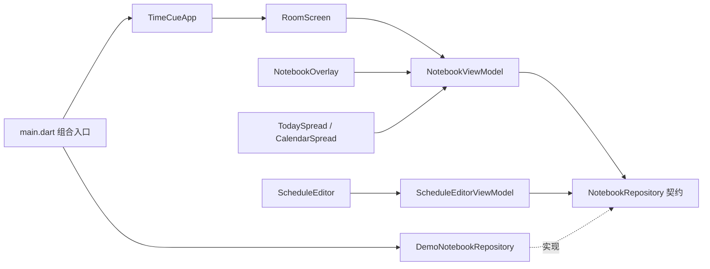

# TimeCue Flutter 桌面视觉骨架

实现 `docs/design/flutter-desktop.md` 的阶段 A：三时段房间、桌面本子、开合动效、今日/待确认双页、日历/右页编辑、添加弹层。全部交互使用显式内存示例仓储，重启复原。没有接入 Go、SQLite、通知、托盘、自启或子进程管理；当前原生关闭窗口直接退出视觉示例。

```powershell
cd D:\go_project\src\TimeCue\desktop
flutter pub get
flutter run -d windows --dart-define=TIMECUE_DEMO=true
```

未传入示例开关时显示启动说明，不自动冒充正式业务数据。示例业务时间固定为北京时间 **2026-10-07 14:32**，环境时钟按真实 UTC+8 自动切换早晨、午后、夜晚。

## Widget 组合关系

```text
TimeCueApp                              MaterialApp、主题、构造注入
└─ DesktopShell                         Scaffold、窗口内主屏
   └─ RoomScreen                        Stack、入口焦点、本子显隐
      ├─ RoomBackdrop                   图片淡入、玻璃 ClipPath、明暗遮罩
      ├─ RoomClock                      独立 ValueListenableBuilder
      ├─ DeskNotebookHotspot            原图本子的透明家具入口
      ├─ RoomActions                    固定入口、待确认数量
      ├─ 添加日程按钮
      └─ NotebookOverlay                焦点作用域、单控制器开合、遮罩
         └─ NotebookFrame               书封、页脚、标签、关闭按钮
            ├─ TodaySpread              第一组跨页
            │  ├─ PaperPage             今日安排 → TriggerRow
            │  └─ PaperPage             待确认、选择工具栏、分页、逐条确认
            └─ CalendarSpread           第二组跨页
               ├─ PaperPage             月份导航 → MonthGrid
               └─ PaperPage             互斥右页
                  ├─ BlankPage          首次进入，无内容
                  ├─ DateListPage       日期清单 → TriggerRow
                  └─ EditingPage        ScheduleEditor

RoomScreen → showDialog
└─ ScheduleCreateDialog                 草稿、关闭守卫、弹层焦点
   └─ ScheduleEditor                    与右页编辑共用表单
      ├─ 名称、说明、类型
      ├─ 日期/时间选择                  分钟精度，UTC+8
      │  └─ NotebookTimePicker          暖色细针转盘 → NotebookTimeDial
      ├─ 周期启停                       单次不展示
      └─ 保存、返回、删除               类型不可变，已到期单次时间只读
```

`NotebookFrame` 通过 `spread` 插槽承载其中一组跨页，两个 `PaperPage` 各自纵向滚动。小窗口或高文本缩放保留两页最小可操作宽度并允许横向访问，标签和关闭按钮固定在书封上。

## 依赖和状态所有权



| 状态 | 所有者 | Widget 的关系 |
| --- | --- | --- |
| 业务示例快照、确认结果 | 示例仓储 | 只读 DTO；确认/保存/删除必须调用契约 |
| 标签、月份、互斥右页、跨页勾选 | NotebookViewModel | 跨页监听状态，只发送界面操作 |
| 开合阶段、动画进度、编辑会话 | NotebookOverlay | 内容到位后才可操作；导航时守卫草稿 |
| 字段、草稿、保存错误 | ScheduleEditorViewModel | 创建弹层与右页编辑复用表单 |
| 真实环境时间 | RoomClockController | 每秒重读 UTC+8，恢复前台立即同步 |
| 场景已解码图片 | RoomBackdrop | 解码成功再淡入，失败保留旧图 |
| 入口焦点、本子显隐 | RoomScreen | 合上后回到实际入口；热区裁切后回固定入口 |

业务快照不与表单共享可变对象。每次确认针对触发 ID；失败投递也可确认，确认不会将失败改成成功。全选只选择点击时本页记录，跨页保留，确认没有撤销。删除与未来编辑保留历史。

示例预设支持单次、每天、每周（所选日期的星期）、每月（所选日号），仅用于视觉演示。正式接入不能用示例投影代替 Go 的查询、调度和规则处理。

## 验证

```powershell
dart format --output=none --set-exit-if-changed lib test
flutter analyze
flutter test
flutter build windows --release --dart-define=TIMECUE_DEMO=true
```

本机沿用已有 Flutter `3.49.0-1.0.pre-240` / Dart `3.14.0` 开发版，没有更换 SDK；CI 使用 stable 验证。本轮不加入桌面第三方插件。

表单、日期选择、时间转盘、按钮与确认弹层统一使用米色纸张和暖棕主题，包括焦点边框、选中日期及文本选择；完成事实仍用鼠尾草绿区分。截图工具还输出日期选择和舍弃草稿弹层，便于对照统一后的颜色。

测试覆盖触发独立确认、投递结果保留、跨页选择、日历空白、右页编辑、Escape、减少动效、窄窗口与文本缩放、cover 几何及三时段边界。Windows 中文输入法、不同 DPI/显示器、实际视觉和系统恢复仍需真机验收。

本机可运行 `flutter test tool/capture_visuals_test.dart`，使用 Windows 中文字体生成房间、今日、空白日历、右页编辑和添加弹层截图，保存在 `build/visuals/`。该工具用于视觉检查，不作跨平台像素断言。

时间选择器统一使用暖色纸面、封面棕色细针及当前数字高亮。小时采用 24 小时双圈、每格 30°；分钟保留 1 分钟精度、每格 6°，整五分钟显示标签，当前非整五分钟单独显示。拖动吸附刻度，滚轮和方向键每次改变一格。左侧小时、分钟数字原位输入，聚焦切换对应转盘，合法输入与指针即时联动，转盘操作回填同一输入框；范围校验为小时 0–23、分钟 0–59。截图工具额外输出小时与分钟转盘截图。

资源：`assets/room/b-anime-{morning,afternoon,night}.png` 逐字节复制自设计目录 `anime-room-times-2026-10-02/`；图像锚点与玻璃多边形沿用原型。背景不参与朗读。

桌面本子直接使用背景图中已有的插画，保留原图的纸页、笔、厚度和阴影。`DeskNotebookHotspot` 只提供透明点击入口：原图本子四角经同一 cover 变换后与视口求交，裁切后露出的部分仍可点击，完全移出视口才隐藏。热区按可见轮廓裁切，开合起点取可见区域；键盘聚焦时显示边界，点击后打开真正的 Flutter 双页本子。
