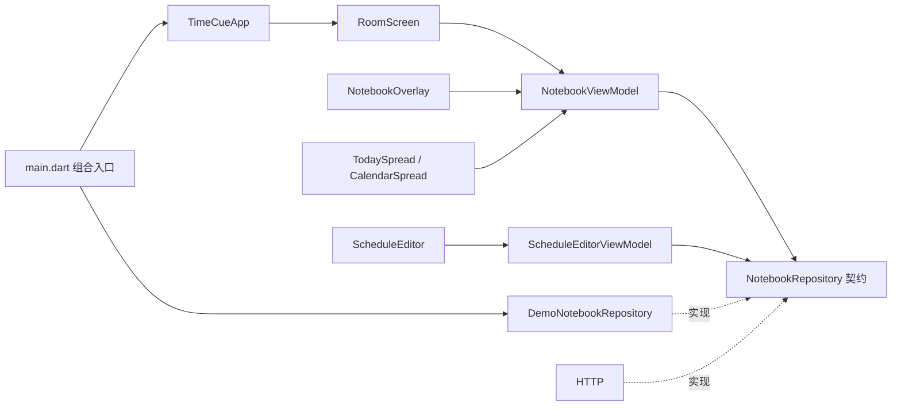

# TimeCue Flutter 桌面端

```powershell
go run ./cmd/flutter
```

另一个终端运行桌面界面：

```powershell
cd D:\go_project\src\TimeCue\desktop
flutter pub get
flutter run -d windows
```

视觉演示仍可显式使用 `flutter run -d windows --dart-define=TIMECUE_DEMO=true`。示例业务时间固定为北京时间 **2026-10-07 14:32**，数据只在内存，环境时钟使用真实 UTC+8。


### HTTP 查询契约

沿用 `/api/v1/scheduler/schedules`，无 view 参数时保持原日程规则列表。日期与月份使用参数选择查询视图。提醒资源使用 `/api/v1/notifications`，与 scheduler 同级：

| 请求 | 返回 |
| --- | --- |
| `GET /schedules?view=occurrences&include=unacknowledged` | 北京时间今日与待确认首分页的同一事务快照；可附 date |
| `GET /schedules?view=occurrences&date=YYYY-MM-DD&cursor=...` | 日期触发清单及续页 |
| `GET /schedules?view=calendar&month=YYYY-MM` | 月份日期标记 |
| `GET /notifications?state=unacknowledged&cursor=...` | 待确认续页 |
| `GET /notifications/:id` | 持久化提醒详情 |
| `POST /notifications/acknowledgements` | `notificationIds` 数组，单条和批量走同一事务操作 |

日期投影的 include 只接受 unacknowledged，组合快照不能附 cursor；续页调用独立的日期或待确认查询。投影视图不混用规则列表的 name/type/limit/offset 参数，不支持参数时返回 400。

### 快照、分页与失败行为

- 待确认默认每页 50，徽标读取 Go 总数；全选只捕获当前页，跨页选择保留，不随后台新记录扩大。批量请求提交明确 ID，最多 500 条，非法成员整批拒绝。
- 本子打开期间每 5 秒刷新；打开、恢复前台和确认后立即查询，关闭或后台停止普通轮询。请求代次阻止旧响应覆盖新状态。
- 确认响应同时更新今日、日期清单和待确认；确认失败保持旧内容及选择。确认成功后的刷新失败单独提示，保留已成功的完成事实。
- 日期清单与今日提供加载更多；未来投影使用 Go 的不透明 occurrenceKey，确认使用 notificationId。日历首进为空白，选日期后显示加载/错误/清单。


## Widget 组合关系

```text
TimeCueApp                              MaterialApp、主题、构造注入
└─ DesktopShell                         Scaffold、窗口内主屏
   └─ RoomScreen                        Stack、入口焦点、本子显隐
      ├─ RoomBackdrop                   图片淡入、玻璃 ClipPath、明暗遮罩
      ├─ RoomClock                      独立 ValueListenableBuilder
      ├─ DeskNotebookHotspot            原图本子的透明家具入口
      ├─ RoomActions                    固定入口、待确认数量
      ├─ 添加日程按钮
      └─ NotebookOverlay                焦点作用域、单控制器开合、遮罩
         └─ NotebookFrame               书封、页脚、标签、关闭按钮
            ├─ TodaySpread              第一组跨页
            │  ├─ PaperPage             今日安排 → TriggerRow
            │  └─ PaperPage             待确认、选择工具栏、分页、逐条确认
            └─ CalendarSpread           第二组跨页
               ├─ PaperPage             月份导航 → MonthGrid、管理日程分页弹层
               └─ PaperPage             互斥右页
                  ├─ BlankPage          首次进入，无内容
                  ├─ DateListPage       日期清单 → TriggerRow
                  ├─ LoadingDatePage / ErrorDatePage  真实查询加载与重试
                  └─ EditingPage        ScheduleEditor（完整规则及 revision）

RoomScreen → showDialog
└─ ScheduleCreateDialog                 草稿、关闭守卫、弹层焦点
   └─ ScheduleEditor                    与右页编辑共用表单
      ├─ 名称、说明、类型
      ├─ ＋与 ScheduleTimeChip           明确选择、悬停删除；单次选中后隐藏＋
      │  ├─ 单次合并弹层                左 CalendarDatePicker / 右时间输入与转盘
      │  └─ 周期单项弹层                时间、星期+时间、日号+时间
      │     └─ NotebookTimePicker       暖色细针转盘 → NotebookTimeDial
      ├─ 周期启停                       单次不展示
      └─ 保存、返回、删除               类型不可变，已到期单次时间只读
```

`NotebookFrame` 通过 `spread` 插槽承载其中一组跨页，两个 `PaperPage` 各自纵向滚动。小窗口或高文本缩放保留两页最小可操作宽度并允许横向访问，标签和关闭按钮固定在书封上。

## 依赖和状态所有权



| 状态 | 所有者 | Widget 的关系 |
| --- | --- | --- |
| Go 业务快照、确认结果 / 内存示例 | HTTP / 示例仓储 | 只读 DTO；确认必须调用正式用例，规则变更必须调用正式事务 |
| 标签、月份、互斥右页、跨页勾选 | NotebookViewModel | 跨页监听状态，只发送界面操作 |
| 开合阶段、动画进度、编辑会话 | NotebookOverlay | 内容到位后才可操作；导航时守卫草稿 |
| 字段、草稿、保存错误 | ScheduleEditorViewModel | 创建弹层与右页编辑复用表单，版本冲突保留草稿 |
| 真实环境时间 | RoomClockController | 每秒重读 UTC+8，恢复前台立即同步 |
| 场景已解码图片 | RoomBackdrop | 解码成功再淡入，失败保留旧图 |
| 入口焦点、本子显隐 | RoomScreen | 合上后回到实际入口；热区裁切后回固定入口 |

业务快照不与表单共享可变对象。每次确认针对触发 ID；失败投递也可确认，确认不会将失败改成成功。全选只选择点击时本页记录，跨页保留，确认没有撤销。删除与未来编辑保留历史。

单次、每天、每周、每月统一用＋选择。单次打开左日历/右时间的合并弹层，只能选择一项；选择后只显示圆角日期时间框，删除后＋重新出现。每天每项选择一个时间，每周每项选择一个星期和时间，每月每项选择一个日号和时间；各项独立配对、重复去重，不再手输逗号集合。悬停或键盘聚焦时圆角框右侧显示 ×，点击直接从草稿移除。周期存在时间项时不能混用其它频率，删除全部项后可切换类型。所有时间弹层移除步进按钮/每格说明，保留输入、转盘、滚轮与键盘；取消/确定固定在底部。短月按月末处理仍由 Go 计算。

同频率的旧 cron 日期列表可拆成独立可编辑项，包括各时间对应不同日期集合；保存按每个时间真实对应的日期生成 cron，不扩展成日期与时间的笛卡尔积。混合频率的旧 cron 保留原文，只改名称、说明和启停。


已完成阶段 A 视觉骨架、阶段 B 查询确认及阶段 C 规则变更。默认通过本机 HTTP 连接 Go；Flutter 不打开 SQLite、不展开 cron。Go 服务须先按 [迁移说明](../migrations/README.md)建立数据库，并在仓库根目录手动启动：

真实模式提供今日安排、日期清单及详情、月份标记、跨日期待确认分页、单条和多选批量确认。未来 pending 与规则投影去重；投递失败或尚未投递的到期记录均可确认，投递结果独立保留。服务未运行时显示连接失败与重试，不回退为示例数据。

真实模式已开放创建、编辑、暂停/恢复及删除；管理日程入口包含暂停规则。调度、系统通知及发布生命周期仍留待 D/E。

Go 的核心实体仍是 Schedule 和 Notification，辅助版本及回执表服务于历史区间与幂等。

## 验证

本机沿用已有 Flutter `3.49.0-1.0.pre-240` / Dart `3.14.0` 开发版，没有更换 SDK；CI 使用 stable 验证。本轮不加入桌面第三方插件。

表单、日期选择、时间转盘、按钮与确认弹层统一使用米色纸张和暖棕主题，包括焦点边框、选中日期及文本选择；完成事实仍用鼠尾草绿区分。截图工具还输出日期选择和舍弃草稿弹层，便于对照统一后的颜色。

测试覆盖触发独立确认、投递结果保留、跨页选择、日历空白、右页编辑、Escape、减少动效、窄窗口与文本缩放、cover 几何及三时段边界。Windows 中文输入法、不同 DPI/显示器、实际视觉和系统恢复仍需真机验收。

本机可运行 `flutter test tool/capture_visuals_test.dart`，使用 Windows 中文字体生成房间、今日、空白日历、右页编辑和添加弹层截图，保存在 `build/visuals/`。该工具用于视觉检查，不作跨平台像素断言。

时间选择器统一使用暖色纸面、封面棕色细针及当前数字高亮。小时采用 24 小时双圈、每格 30°；分钟保留 1 分钟精度、每格 6°，整五分钟显示标签，当前非整五分钟单独显示。拖动吸附刻度，滚轮和方向键每次改变一格。左侧小时、分钟数字原位输入，聚焦切换对应转盘，合法输入与指针即时联动，转盘操作回填同一输入框；范围校验为小时 0–23、分钟 0–59。截图工具额外输出小时与分钟转盘截图。

资源：`assets/room/b-anime-{morning,afternoon,night}.png` 逐字节复制自设计目录 `anime-room-times-2026-10-02/`；图像锚点与玻璃多边形沿用原型。背景不参与朗读。

桌面本子直接使用背景图中已有的插画，保留原图的纸页、笔、厚度和阴影。`DeskNotebookHotspot` 只提供透明点击入口：原图本子四角经同一 cover 变换后与视口求交，裁切后露出的部分仍可点击，完全移出视口才隐藏。热区按可见轮廓裁切，开合起点取可见区域；键盘聚焦时显示边界，点击后打开真正的 Flutter 双页本子。


日历底部显示选中日期的启用日程数量，未选日期时显示今天：零条为“无日程”，否则为“当日共 N 个日程”。确认与未确认都计入，暂停、删除、取消不计入；同一日程当天多次提醒只计一个。Go 的日期页在分页前返回 `openScheduleCount`，Flutter 直接使用完整总数，不按当前页长度或待确认条数计算。读取失败不会显示成“无日程”。实心底色仅表示选中日期。

每个日期格都预留相同的安排标记空间；未标记日期隐藏小点但保留布局高度，保证有安排和无安排的日期数字在同一行水平对齐。