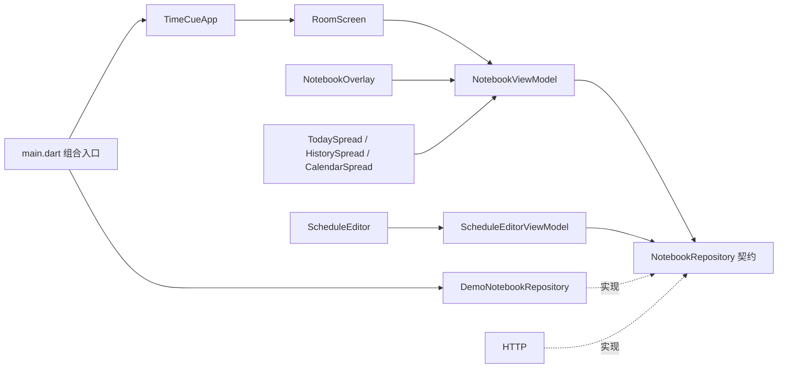

# TimeCue Flutter 桌面端

```powershell
go run ./cmd/flutter --data-dir .
```

另一个终端运行桌面界面：

```powershell
cd D:\go_project\src\TimeCue\desktop
flutter pub get
flutter run -d windows -a --backend=external -a --data-dir=D:\go_project\src\TimeCue
```

视觉演示仍可显式使用 `flutter run -d windows --dart-define=TIMECUE_DEMO=true`。示例业务时间固定为北京时间 **2026-10-07 14:32**，数据只在内存，环境时钟使用真实 UTC+8。

## Windows 系统提醒

真实模式启动一个应用级 Windows 通知执行者；external 连接手动 Go，managed 在自有 Go 的 ready/health 双重核验后开放业务，先核对 `/health` 的 v1、delivery-v1 和 recovery-v1。每秒领取最多 20 个完整任务，按 Go 的开始决定调用一次即时通知，再回填 sent/failed；单条、多条和恢复汇总均使用 Go 冻结文案。关闭本子或失去焦点不会停止领取，显式演示不接真实通知。

插件固定为 flutter_local_notifications 22.3.1，CI 和平台验收使用 Flutter 3.47.0，保留原本机 master SDK。应用身份固定为 TimeCue.Desktop；初始化失败保留房间窗口并显示连接重试入口。Windows 构建需要正常插件路径支持，缺少符号链接权限的本地环境可在 windows/flutter/ephemeral/.plugin_symlinks 使用指向 Pub 缓存的目录联接；该临时目录不提交。

attempt、平台整数映射和待回填结果只在内存。重复领取、开始或结果重传不追加同 attempt 的展示；平台接受请求才记录 sent，横幅被系统抑制、未阅读或未确认不改变该执行语义。连接失败只重传已知结果，Go 新 attempt 才能再次展示。Go 重启后旧身份失效，Flutter 重启不恢复回执文件；展示后尚未回填即崩溃，后续运行可能再次展示。

宿主退出请求先停止新领取和展示，最多 5 秒尽力提交已知结果；通知桥另提供 stopAndDrain(budget) 供 D8 共用停止预算，不停止手动 Go。系统通知的 payload 只携带运行/任务/尝试/类型身份，点击不确认；点击定位与恢复页面已由 D6 接入；D7 已接入托盘、单实例及明确退出，D8 已接入自有 Go 进程与 Job 清理；登录自启仍由 D9 接入。实现和验收范围见 [D5 规划](../docs/design/phase-d5-windows-notification-bridge.md)。


### HTTP 查询契约

沿用 `/api/v1/scheduler/schedules`，无 view 参数时保持原日程规则列表。日期与月份使用参数选择查询视图。提醒资源使用 `/api/v1/notifications`，与 scheduler 同级：

| 请求 | 返回 |
| --- | --- |
| `GET /schedules?view=occurrences&include=unacknowledged` | 北京时间今日与待确认首分页的同一事务快照；可附 date |
| `GET /schedules?view=occurrences&date=YYYY-MM-DD&cursor=...` | 日期触发清单及续页 |
| `GET /schedules?view=calendar&month=YYYY-MM` | 月份日期标记 |
| `GET /notifications?state=unacknowledged&cursor=...` | 待确认续页 |
| `GET /notifications?state=unacknowledged&scope=today&cursor=...` | 今日首/续页及完整 total；scope=history 为昨日及更早，跨范围/北京日期游标返回 400 |
| `GET /notifications/:id` | 持久化提醒详情 |
| `GET /notifications?deliveryTaskId=...&attemptId=...&cursor=...` | 查看本次通知的冻结成员；不附 attemptId 时读取本轮任务历史，每页 50 条 |
| `POST /notifications/acknowledgements` | `notificationIds` 数组，单条和批量走同一事务操作 |

日期投影的 include 只接受 unacknowledged，组合快照不能附 cursor；续页调用独立的日期或待确认查询。投影视图不混用规则列表的 name/type/limit/offset 参数，不支持参数时返回 400。

提醒 deliveryStatus 为 pending/loaded/sent/failed。loaded 是 Go 预加载/等待执行状态，详情与 pending 一样显示待投递；用户确认独立于平台展示结果。该枚举已通过 D1 Apifox 验收后接入界面。

通知点击读取 payload 中的 instanceId、deliveryTaskId、attemptId、taskType；核对 `/health` 后打开唯一只读视图，单条 minute 显示完整详情，多条/recovery 显示本次冻结成员。旧运行提示定位失效，不自动改查全量待确认；已知 notificationId 仍可独立读取持久详情。查看、刷新及翻页不确认，不改变投递执行者或本子草稿/选择。实际系统横幅点击仍待真机确认，窗口唤回及显式激活参数转交已由 D7 接入；系统通知完整冷启动链路仍由 D8/E 核验。

组合快照的 recovery 摘要用于房间卡片及本子入口；running/failed/completed 描述历史整理，未知 missedTotal 保持未知，through 为本轮整理上界。恢复入口不附 attemptId，分页读取完整任务历史；整理中空页不表示没有遗漏。成员页 409 有界重读首页，400 废弃游标，断线保留旧内容并允许重试。只读列表前台每五秒刷新当前页，关闭/后台停止普通查询，恢复前台重读首页；房间在未完成整理时继续前台普通刷新。

点击房间恢复卡片打开记录后，该轮提示在当前运行内隐藏，关闭详情或刷新同轮状态不会重新显示；新的恢复轮次重新显示。本子中的恢复记录入口仍可随时打开。确认成功后废弃旧恢复提示数量，再读取 Go 的新统计；刷新失败时不沿用已过期的计数，房间前台继续普通刷新至数量明确归零。

房间卡片提示“有 N 条遗漏提醒”，N 为本轮尚未确认数 unacknowledgedCount；全部确认后不再提示，未知数量或完整历史尚未整理完成时不显示。投递成功、暂停及停止不等于用户确认；历史详情保留完整遗漏和独立投递状态，其他日程的待确认数不混入本轮计数。

### 快照、分页与失败行为

- 标签依次为今天、历史待确认、日历。今日左页保留今日全部安排，右页仅今日到期未确认；历史按原计划完整日期分组，四种投递状态保持真实。两类待确认默认每页 50，房间徽标读取组合快照的全部待确认总数；全选只捕获当前页，跨页选择保留，不随后台新记录扩大。批量请求提交明确 ID，最多 500 条，非法成员整批拒绝。
- 今日/历史各自保存分页位置、游标、加载/错误及选择；普通刷新保留有效位置，范围游标不混用。成功发布新北京日期时两类回首分页并清空旧范围选择，新历史记录不自动选中；混合日期及旧响应不发布，400 后重读首分页，跨日读取失败保留内容并阻止旧今日选择提交。
- 本子打开期间每 5 秒刷新；打开、恢复前台和确认后立即查询，关闭或后台停止普通轮询。请求代次阻止旧响应覆盖新状态。
- 确认响应同时更新今日、日期清单和待确认；确认失败保持旧内容及选择。确认成功后的刷新失败单独提示，保留已成功的完成事实。
- 日期清单与今日提供加载更多；未来投影使用 Go 的不透明 occurrenceKey，确认使用 notificationId。日历首进为空白，选日期后显示加载/错误/清单。


## Widget 组合关系

```text
TimeCueApp                              MaterialApp、主题、构造注入
└─ DesktopShell                         Scaffold、窗口内主屏
   └─ RoomScreen                        Stack、入口焦点、本子显隐
      ├─ RoomBackdrop                   图片淡入、玻璃 ClipPath、明暗遮罩
      ├─ RoomClock                      独立 ValueListenableBuilder
      ├─ DeskNotebookHotspot            原图本子的透明家具入口
      ├─ RoomActions                    固定入口、待确认数量
      ├─ 添加日程 / 管理日程按钮（包含已暂停）
      └─ NotebookOverlay                焦点作用域、单控制器开合、遮罩
         └─ NotebookFrame               书封、页脚固定管理入口、标签、关闭按钮
            ├─ TodaySpread              第一组跨页
            │  ├─ PaperPage             今日安排 → TriggerRow
            │  └─ PaperPage             待确认、选择工具栏、分页、逐条确认
            ├─ HistorySpread            第二组跨页：完整日期分组、历史说明
            │  └─ PendingList           共用状态/详情/选择/确认/分页
            └─ CalendarSpread           第三组跨页
               ├─ PaperPage             月份导航 → MonthGrid、管理日程分页弹层
               └─ PaperPage             互斥右页
                  ├─ BlankPage          首次进入，无内容
                  ├─ DateListPage       日期清单 → TriggerRow
                  ├─ LoadingDatePage / ErrorDatePage  真实查询加载与重试
                  └─ EditingPage        ScheduleEditor（完整规则及 revision）

RoomScreen → showDialog
├─ ScheduleManagementDialog             含已暂停规则、分页和详情读取
│  └─ ScheduleEditDialog                独立修改弹窗，保存/恢复/删除后刷新列表
└─ ScheduleCreateDialog                 草稿、关闭守卫、弹层焦点
   └─ ScheduleEditor                    与右页编辑共用表单
      ├─ 名称、说明、类型
      ├─ ＋与 ScheduleTimeChip           添加、点击修改、悬停删除；单次选中后隐藏＋
      │  ├─ 单次合并弹层                左 CalendarDatePicker / 右时间输入与转盘
      │  └─ 周期单项弹层                时间、星期+时间、日号+时间
      │     └─ NotebookTimePicker       暖色细针转盘 → NotebookTimeDial
      ├─ 周期启停                       单次不展示
      └─ 保存、重新开启、返回、删除     类型不可变，已到期单次时间只读
```

`NotebookFrame` 通过 `spread` 插槽承载其中一组跨页，两个 `PaperPage` 各自纵向滚动。小窗口或高文本缩放保留两页最小可操作宽度并允许横向访问，标签和关闭按钮固定在书封上。

## 依赖和状态所有权



| 状态 | 所有者 | Widget 的关系 |
| --- | --- | --- |
| Go 业务快照、确认结果 / 内存示例 | HTTP / 示例仓储 | 只读 DTO；确认必须调用正式用例，规则变更必须调用正式事务 |
| 标签、月份、互斥右页、两范围分页及跨页勾选 | NotebookViewModel | 跨页监听状态，只发送界面操作 |
| 开合阶段、动画进度、编辑会话 | NotebookOverlay | 内容到位后才可操作；导航时守卫草稿 |
| 字段、草稿、保存错误 | ScheduleEditorViewModel | 创建弹层、独立修改弹窗与右页编辑复用表单，版本冲突保留草稿 |
| 真实环境时间 | RoomClockController | 每秒重读 UTC+8，恢复前台立即同步 |
| 通知执行阶段、Go 运行代次、平台 ID 和待回填结果 | WindowsNotificationBridge | 应用级内存状态；独立于本子轮询，业务结果经 Go 正式接口回流 |
| 激活目标、任务/attempt 分页、只读详情及读取代次 | NotificationViewModel | 宿主唯一只读弹窗，不写业务；过期身份提示和持久详情分别处理 |
| 场景已解码图片 | RoomBackdrop | 解码成功再淡入，失败保留旧图 |
| 入口焦点、本子显隐 | RoomScreen | 合上后回到实际入口；热区裁切后回固定入口 |

业务快照不与表单共享可变对象。每次确认针对触发 ID；失败投递也可确认，确认不会将失败改成成功。全选只选择点击时本页记录，跨页保留，确认没有撤销。删除与未来编辑保留历史。

关闭（暂停）周期只停止未来安排，不隐藏规则信息。在房间点击“管理日程”，或使用日程本书封的固定管理入口，即可查看包含已暂停日程的分页列表、名称、说明、时间规则和启停状态。点击日程读取完整详情并打开独立“修改日程”弹窗，不打开本子或切换本子页面，也不舍弃本子原有草稿。保存、重新开启或删除成功后回到当前管理分页并刷新，取消返回原列表；修改弹窗有未保存修改时，关闭需经过舍弃守卫。“重新开启”沿用原 revision 和正式 Go 更新接口，保留原规则，从下一次未来触发继续。读取失败保留列表并可重试，写入失败保留修改弹窗、草稿及错误。

日历底部显示选中日期的启用日程数量，未选日期时显示今天：零条为“无日程”，否则为“当日共 N 个日程”。确认与未确认都计入，暂停、删除、取消不计入；同一日程当天多次提醒只计一个。Go 的日期页在分页前返回 `openScheduleCount`，Flutter 直接使用完整总数，不按当前页长度或待确认条数计算。读取失败不会显示成“无日程”。实心底色仅表示选中日期。

每个日期格都预留相同的安排标记空间；未标记日期隐藏小点但保留布局高度，保证有安排和无安排的日期数字在同一行水平对齐。

单次、每天、每周、每月统一用＋选择。单次打开左日历/右时间的合并弹层，只能选择一项；选择后只显示圆角日期时间框，删除后＋重新出现。每天每项选择一个时间，每周每项选择一个星期和时间，每月每项选择一个日号和时间；各项独立配对、重复去重，不再手输逗号集合。悬停或键盘聚焦时圆角框右侧显示 ×，点击直接从草稿移除。周期存在时间项时不能混用其它频率，删除全部项后可切换类型。所有时间弹层移除步进按钮/每格说明，保留输入、转盘、滚轮与键盘；取消/确定固定在底部。短月按月末处理仍由 Go 计算。

已有圆角时间框可直接点击修改，单次、每天、每周、每月共用同一交互。选择器预填当前项的日期、星期或日号及时间，确认后原位替换，取消保留原值，不影响其它时间项；周期重复替换会提示且保留原项。点击右侧 × 仍只删除该项；已到期单次时间按历史规则只读。修改先保留在草稿，点击“保存日程”后生效。

同频率的旧 cron 日期列表可拆成独立可编辑项，包括各时间对应不同日期集合；保存按每个时间真实对应的日期生成 cron，不扩展成日期与时间的笛卡尔积。混合频率的旧 cron 保留原文，只改名称、说明和启停。

每月时间选择与单次共用左右排版，左侧是 1–31 日号网格及短月说明，右侧是时间输入与转盘，底部操作固定。每月仍选择重复日号，不引入具体年月。

## 用户配置存储

`ConfigFileStore(dataDir)` 是 Flutter 的用户配置文件写入入口，dataDir 与启动 Go 时传入的根目录一致。`read()` 只返回日志级别、日志路径和数据库路径的用户覆盖值；null 表示继承 Go 的原有内嵌默认值，前端不复制或修改 default.yaml。

`update(logLevel: ..., logPath: ..., databasePath: ...)` 校验字段并原子保存到 config.yaml，保留 YAML 注释、未知字段及 app/desktop 配置；同一文件的多实例操作串行执行。`restoreRuntimeDefaults()` 只移除三个运行字段，保留其余内容。结果 pathsChanged 表示保存的路径字段发生变化，供设置界面提示下次启动应用；本组件不切换数据库连接、不搬迁文件。

Go config 只读、监听并发布快照，日志级别按现有机制热更新，数据库和日志路径由 Go 启动生命周期应用。存储组件可供后续设置页及桌面配置功能装配；当前没有新增配置 HTTP 接口或编辑页面。

## 托盘与单实例

window_manager/tray_manager 均固定 0.5.2。原生 runner 在创建 Flutter 引擎前选择当前用户/会话的唯一宿主；重复启动只向已有实例转交请求，不创建第二个业务执行者。托盘左键与“打开 TimeCue”复用原窗口，右键提供打开/退出菜单。标题栏关闭及 Alt+F4 隐藏到托盘，最小化保持普通行为；提醒执行不随隐藏停止。托盘缺失/失效时保持可见窗口，提供重试及明确退出。窗口显示由原生线程同步完成后返回可见性，窗口故障提供“重试窗口”，成功重试移除旧提示。

“退出 TimeCue”先停止新工作，在总计 5 秒内尽力回填已知结果，再释放共享资源并销毁窗口；开发外连的手动 Go 保持运行。运行状态、激活意图和转交去重都不落盘。窗口状态只读，插件结果及原生图标核验经生命周期正式操作更新，迟到事件不重新打开已退出的窗口。

原生参数白名单为 `--start-hidden`、`--login-start`、`--activation-payload=<原 JSON>` 及首次装配的 `--backend=managed|external`、`--data-dir=<目录>`、`--go-executable=<绝对文件>`。首次隐藏/登录意图只有托盘可用才隐藏；重复普通启动唤回，重复登录意图保持当前可见性。显式 payload 只用于适配/调试，原始 instance/task/attempt/type 经同一 D6 入口核验；重复启动省略运行选项表示复用；显式目录、exe 或模式冲突在原生接纳前拒绝，不能切换当前运行。这些入口不读取自启配置、不注册启动项，也不保证系统通知可以冷启动已退出应用。

在 desktop 验证原生协议与进程：

```powershell
cmake -S test/native -B build/d7-native -A x64
cmake --build build/d7-native --config Release
ctest --test-dir build/d7-native -C Release --output-on-failure
```

原生测试使用独立锁名、自有隐藏子进程与真实 Win32 消息，覆盖并发选主、Unicode、缓冲/去重、非法参数、无响应及崩溃恢复，不触及已有用户实例。实际系统横幅点击与真正 Explorer 重启须另外进行人工验收，不能由合成消息替代。任务及证据见 [D7 规划](../docs/design/phase-d7-tray-single-instance.md)和[D7 验收记录](../docs/design/phase-d7-validation.md)。

## 自有 Go 子进程

真实模式显式提供绝对 data-dir。默认 backend 保持 external，不拥有手动 Go；managed 还需指定已编译 Go 的绝对路径。编译和运行示例（先在仓库根目录，数据库已手动迁移）：

```powershell
$timecueDataDir = (Resolve-Path .).Path
New-Item -ItemType Directory -Force .gotmp-d8 | Out-Null
go build -o .gotmp-d8/timecue-go.exe ./cmd/flutter
$timecueGoExe = (Resolve-Path .gotmp-d8/timecue-go.exe).Path
cd desktop
flutter build windows --release
& .\build\windows\x64\runner\Release\timecue_desktop.exe --backend=managed "--data-dir=$timecueDataDir" "--go-executable=$timecueGoExe"
```

Go 隐藏创建且在创建时进入自有 Job；子端仅继承 stdin/stdout/stderr 管道。ready 单行上限 16 KiB，创建、ready、/health 和存活核验共用 10 秒，核对新 instanceId、持有进程 PID、固定地址、v1 与四项 D4 能力。握手前不挂载业务房间、不领取或展示；启动错误保持窗口可见，可显式重试或退出。配置存储从同一启动快照取 data-dir，不自动初始化或迁移数据库。

明确退出先停新工作并尽力回填原结果，再以剩余 5 秒共享预算发送 shutdown/EOF 和等待；最终回收不受零预算影响，关闭 Job 并释放句柄。宿主崩溃由内核 Job 清理自有 Go/后代。运行中 Go 退出后旧任务与异步结果失效，不自动重启、不接管其他端口服务；外连模式仍可跟随手动 Go 的新运行，退出 Flutter 不停止它。

`tool/d8_host_smoke.dart` 是隔离联调入口，必须传入新建且手动迁移的测试目录。测试构建用 `flutter build windows --release --target=tool/d8_host_smoke.dart`；正常发行构建恢复为 `flutter build windows --release`。真实平台接受请求和结果回流可由该入口证明，系统横幅视觉、点击、休眠/关机与完整冷启动仍需单独取得证据；当前插件未注册 LocalServer32，不宣称已完成系统通知冷启动。详情见 [D8 任务](../docs/design/phase-d8-process-management.md)与[验收记录](../docs/design/phase-d8-validation.md)。

复跑完整宿主联调（从 desktop 执行；Go exe 为上文编译的文件）：

```powershell
flutter build windows --release --target=tool/d8_host_smoke.dart
python tool/d8_host_smoke.py --go ../.gotmp-d8/timecue-go.exe
python tool/d8_native_go_smoke.py --go ../.gotmp-d8/timecue-go.exe --driver build/desktop-native/Release/d8_native_tests.exe
flutter build windows --release --target=lib/main.dart
```

Python 脚本自行建立并手动迁移新的测试数据库，不接收业务数据库路径。运行时需空闲的 10086 端口；不结束端口占用者。父测试通过隔离文件握手取得自有 Go 观察句柄，再允许宿主完成退出，避免快速退出产生缺失证据。原生驱动路径按实际 CMake build 目录调整。
