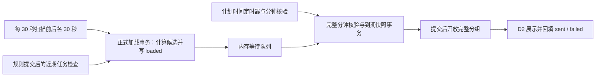

# D1：分钟调度方案

状态：D1 已实现并通过本地与 Apifox 验收，见[验收记录](phase-d1-validation.md)。上位目标见[阶段 D 开发规划](phase-d-development-plan.md)，保存边界见[D0](phase-d0-runtime-state.md)。

## 1. 目标与范围

采用一个后台调度 goroutine：每 30 秒扫描当前时刻前后各 30 秒的任务，计算并保存候选提醒，通过 `notifications.status=loaded` 记录已预加载，将任务加入内存等待队列。到点由定时器唤醒，核验完整分钟成员并保存到期快照，再开放分组给 D2；扫描频率不决定通知触发精度。

日程创建、修改或恢复提交后，若首提醒在未来 1 分钟内，则立即加载入队；更远的首提醒正常保存，等待定时扫描。同一分钟合并为一个完整通知任务，不因扫描批次、每页 50 条或领取上限 20 个任务而拆组。

| D1 交付 | 后续接管 |
| --- | --- |
| 30 秒扫描、loaded 状态、近期任务即时入队、到点核验与快照、退出清理 | D2：claim/start/results、实际展示结果、尝试预算及重试 |
| 当前分钟完整分组及内存去重 | D3：启动前全历史恢复、遗漏汇总及查询进度 |
| 扫描覆盖位置与遗漏区间 | D4：数据目录、实例身份、ready、父进程控制通道 |

复用现有四张业务表和 status 字段，不新增表、字段、迁移、RuntimeStore、租约或心跳。直接修改 `001_initial.up.sql` 的 status CHECK 以支持 loaded，继续使用 001 + 002、版本 2；任务分组、展示次数、attempt、扫描位置和恢复进度仍只保存在内存。

## 2. 现有实现与缺口

| 代码 | 复用内容与待补齐能力 |
| --- | --- |
| `internal/service/next_notify.go` | 复用纯 `nextNotificationTime`，保留 UTC+8、严格未来、每日/每周/每月及短月合并规则；不使用读取当前版本并逐条写库的 `Next` 展开历史。 |
| `internal/store/schedule_change.go` | 已原子保存规则和首提醒、版本区间、变更前到期快照；需扩展 loaded 未来提醒的撤销/复用，并接入提交后的近期任务检查。 |
| `internal/store/notification.go` | 复用 `(schedule_id, notify_time)` 唯一键；需增加加载事务、loaded 查询及结果转换支持。现有 pending 查询不能证明完整分钟成员。 |
| `internal/model/notification.go` | 增加 loaded，status 为当前处理阶段与投递结果共用的生命周期字段。 |
| `migrations/001_initial.up.sql` | 直接扩展原表 status CHECK，允许 pending/loaded/sent/failed；不创建中间表。 |
| `cmd/flutter/main.go` / `internal/service/app.go` | main 只装配适配器和信号；service.App.Run 加载配置并管理 HTTP、调度与退出清理。 |

## 3. 状态所有权与恒定规则

按项目的删除、替换、拆分、重复测试，核心仍为规则有效区间、提醒身份和事实、完整分钟的开放边界。加载状态由正式存储操作修改；内存队列表示本次运行实际等待/执行的任务。



必须成立：

1. 扫描和周期推进独立于投递结果、用户确认；上一条失败或未确认不阻止下一次触发。
2. 提醒身份始终为 `(scheduleID, notifyTime)`；数据库唯一键和内存键共同去重。
3. 加载事务先提交，随后入队。loaded 不能单独证明任务已在当前内存中；重扫和重启必须能补入。
4. 到点先保存完整到期事实和文本快照，再开放投递。只有平台接受展示请求后才记录 sent；到期、展示和确认分别处理。
5. 完整分钟提交前不可领取；任务批次和查询分页不能拆开通知。
6. 已保存快照、sent、确认及永久停止不能被加载或重扫覆盖；未来预加载文本不作为已经发生的历史。
7. 展示次数和尝试身份不持久化；failed 重新加载不得重置本次运行的重试预算。

依赖仍为入口 → service → model/窄存储端口，store 实现端口。核心不依赖 HTTP、Flutter、Windows 或真实时钟。

## 4. status 生命周期与表定义

| 状态 | 含义 |
| --- | --- |
| pending | 已保存候选，尚未进入加载阶段。 |
| loaded | 已办理加载，等待到点、就绪分组或本次执行结果；不代表已经展示。 |
| sent | 平台已接受展示请求。 |
| failed | 最近一次展示失败，等待 D2 决定是否再次加载。 |

正式转换为 `pending → loaded → sent / failed`。D2 检查重试等待和剩余次数后，才能 `failed → loaded`；重启后预算重新建立。重复加载 loaded 幂等，sent 不降级。停止、软删除及确认保留各自已有字段，不增加停止状态，也不伪造 failed。

重新加载会将 failed 改为当前阶段 loaded，因此 status 不再同时保留上一次失败结果。该次运行的失败信息和尝试预算由 D2 内存记录，方案不承诺跨重启保存失败尝试历史。加载、到点及展示开始不会产生新的 sent；D2 结果回填操作才写入 sent/failed。

到点后保留 loaded，由计划时间、到期快照及内存分组区分预加载与就绪，不另增 triggered 状态。D2 start 至少校验已到期、已冻结快照和实际展示资格，不能直接领取未来 loaded 行。

按用户最新要求直接修改 `001_initial.up.sql` 中 notifications.status 的 CHECK，允许 pending/loaded/sent/failed。保留原列、唯一键、索引、外键及 002，user_version 仍为 2；不新增 003、不重建中间表。

同时检查以下依赖：

- 当前待加载查询覆盖 pending/loaded；failed 是否加载由 D2 重试资格决定。
- 更新/删除规则时，未来且未确认的 pending/loaded 均可撤销；未来唯一键复用支持尚未触发的这两类行，不能复活已到期或已执行事实。
- 结果更新接受 loaded/failed，sent 保持不可降级；同一 attempt 的幂等回执由 D2 裁决。
- 详情、日期和待确认查询仍保留 loaded 提醒，不能因新状态漏行。
- 健康检查在版本 2、原表结构检查之外验证 loaded 约束；临时数据库继续用当前 001/002 初始化。

修改建表 SQL 不会自动修改旧库。旧版本 2 数据库若仍使用原 status CHECK，会在健康检查中明确拒绝启动；不能只改 user_version 绕过。此实现仅使用临时新库验收，没有更改本地业务数据库。

`deliveryStatus` 已通过既有 HTTP 查询返回，新增 loaded 属于响应枚举扩展。D1 实现后必须在 Apifox 项目 8902401、环境 49486135 验证查询、变更、确认及 loaded 可见性，再进行 Flutter 状态适配；不新增 HTTP 路由。

## 5. 扫描与即时入队

### 5.1 每 30 秒扫描

启动立即扫描，之后每 30 秒捕获墙上时间 `now`，正常窗口为 `[now-30 秒, now+30 秒)`。从完整规则集合计算此窗口的候选，结合已有提醒幂等加载；普通用户查询的 50 条上限不适用，分页也不能漏掉窗口成员。

加载操作在写事务内取锁、读取覆盖窗口的版本与已有行、调用纯准备函数计算候选、按唯一键保存并校验资格、写 loaded，提交后按计划时间加入等待队列。回调不读库、不调用 Repo、不做外部 I/O；SQLite 单连接下回调再次读库会阻塞自身。

未来候选不冻结快照。规则改时后应撤销旧未来 loaded，修改名称后的未来提醒在到期时使用覆盖计划时刻的版本文本。无法展示的已有事实保留，但不加入等待队列。

每次扫描都允许读取 loaded，再以当前内存键判断是否缺失；不能只查 pending 或把数据库 loaded 当作跨进程去重依据。库已提交但入队失败时保留待入队结果，优先补入，下一轮扫描也能补入。

### 5.2 提交后检查未来 1 分钟

创建、修改和恢复规则沿用已有事务，先保存规则与首提醒。提交后重新读取当前时刻，判断首提醒的计划时间：

- `0 < notifyTime-now <= 1 分钟`：立即通过同一加载操作校验、写 loaded、入队，并通知调度器重设最近唤醒时间。
- 晚于 1 分钟：保留正常 pending，交给定时扫描。
- 提交/排队期间已经到期：立即请求该分钟核验，不等待下一次 30 秒扫描。

检查使用事务返回的首提醒，不再次生成另一条。入队失败不撤销已经成功的规则操作、不将其伪装为写入失败；保留补入请求并由扫描及分钟核验兜底。幂等重放也可检查当前真实行是否缺少队列成员，但不得用旧回执恢复已撤销的安排。

修改、暂停、取消、删除及确认提交后，使相关尚未开始成员失效；已开始尝试由 D2 保留身份并按实际结果回填。队列操作只使用窄入口，不建设通用事件总线。

### 5.3 定时唤醒、间隙与回拨

一个 goroutine 管理扫描时刻、最近任务定时器、下一分钟边界及提交后唤醒信号。等待队列按计划时间排序，到点触发不等下次扫描。没有预加载任务时也保留下一分钟核验，覆盖提交成功但即时入队尚未完成的间隙。实际已核验分钟使用内存集合去重，不能用最大分钟位置跳过回拨后尚未处理的新分钟；回拨立即使扫描到期，失败后继续重试。

每次成功加载并安排补入后，记录扫描覆盖终点；失败不推进。若新窗口起点晚于原覆盖终点，登记缺失半开区间并交 D3，随后处理当前窗口，不用多年空分钟扫描阻塞实时任务。超过窗口的旧 loaded 同样交恢复处理。

休眠恢复时立刻重扫并核验当前分钟；已逾期的更早分钟任务归遗漏恢复，不能逐条展示。时钟前拨产生的间隙交 D3；回拨不重置已有任务预算、不重复开放已完成分钟，等待未来任务重新到点。记录覆盖区间时不因回拨倒退原进度。

恢复位置、遗漏区间及当前队列只保存在内存。D3 接入前仅登记和记录遗漏，不宣称全期间已恢复。

## 6. 到点核验与完整分钟

分钟键 `M` 使用固定 UTC+8，秒和纳秒为零；分钟区间为 `[M, M+1 分钟)`。新规则已有分钟精度约束，旧秒级单次事实保留查询，不取整、不加入 D1 分组。

预加载是候选缓存。到点执行一次 `PrepareDueMinute(M)` 写事务：

1. 取得写锁，读取覆盖该分钟的完整规则版本、已有提醒及停止依据，不只读取内存成员或 loaded。
2. 复用纯规则计算，补齐遗漏候选，包括两次扫描之间提交成功而尚未入队的近期任务。
3. 为有效触发保存提醒事实，并仅对未冻结的到期行保存正确名称/说明和 `snapshot_taken=1`。已经冻结的内容、真实结果、确认及停止标记保持不变。
4. 将未停止且可进入本次等待/执行的 pending 转为 loaded；已有 failed 仍受 D2 重试约束，不因分钟核验自动重置为 loaded。
5. 返回完整事实集合和可投递候选，提交后开放一个完整分组。中途错误回滚整分钟，数据库已提交但发布失败则保留结果幂等重发。

没有可投递成员的分钟仍记为核验完成，不创建空任务。完整事实数量排除到期前撤销的 deleted 候选和旧秒级记录。一个运行内重复核验/发布不能创建第二个分钟任务。D3 每事务 500 条的限制针对历史补齐，不拆开 D1 的单分钟完整事务；大组需验证写锁耗时。

分组按本次运行的分钟键去重，保存完整事实 ID 和当前候选 ID，返回只读副本。D2 再赋予对外任务/attempt 身份，并在 start 重检成员、冻结实际展示集合和文案：单成员显示名称时间，多成员只显示数量。

启动边界取当前分钟 M0；启动时即核验 M0，D3 处理严格早于 M0 的历史。当前分钟不会因启动发生在中途而被切成两个分组。重启后所有可展示 loaded 均失去旧内存关联：当前分钟重新核验、未来窗口重新加载、更早到期记录交 D3，不依据 loaded 跳过任务，也不恢复旧 attempt。

## 7. 版本归属与竞争

沿用现有正式写入边界：版本产生的触发满足 `T > effective_from`，若有结束边界，还须 `T <= effective_until`。创建/恢复严格生成未来首提醒，变更前冻结 `notify_time <= effectiveAt` 的旧事实。

例如 09:00:00 修改规则，09:00 原触发归旧版本；09:00:20 改名，09:00 仍使用旧名称。纯分钟计算使用 `nextNotificationTime(version.Schedule, M-1 纳秒)`，仅接受结果等于 M 并检查版本边界；同刻的中间零长度版本没有触发，多 cron 重合按唯一键合并。

| 竞争 | 结果 |
| --- | --- |
| 预加载后改时或改名 | 旧未来安排撤销并移出队列；新近期首提醒即时加载，到期重新核验文本版本。 |
| 新增 09:00 任务发生在 08:59:50 | 提交后立即入队，09:00 核验时进入同一个完整分组。 |
| 预加载或核验与规则写入并发 | 存储写锁裁决，纯计算依据事务内版本，不用过期内存规则直接执行。 |
| 暂停/删除/确认发生在核验后、展示前 | D2 start 排除失去资格的成员，事实保留，不伪造失败。 |
| 暂停后恢复，旧分钟稍后补造 | 检查触发后的停止版本，补造历史永久停止；不因当前已恢复而复活。 |
| failed 遇到重扫或周期推进 | 不改变预算和重试等待；下一次周期触发仍独立生成。 |

历史有效触发与现在可展示集合分别统计，已 sent/已确认/永久停止不重新加载。002 以前未记录的规则边界不猜测补造；已有历史及快照保留。

D3 补齐历史后，未开始的遗漏任务通过内存转换转入汇总，已开始任务由 D2 保留身份和计数；loaded 不能代替 attempt.started 的判断。

## 8. 模块落点与实施顺序

| 模块 | 变更 |
| --- | --- |
| `internal/service/scheduler.go` | 单 goroutine、30 秒扫描、任务/分钟定时器、主动唤醒、覆盖进度和遗漏登记。 |
| `internal/service/notification_loading.go` | 窗口候选纯计算、正式加载用例、提交后的 1 分钟检查。 |
| `internal/service/scheduler.go` | 同时维护到点完整分钟核验、等待队列、分钟去重、成员失效及受控读取；预算由 D2 管理。 |
| `internal/model` / `internal/store` | loaded 枚举、窄事务输入、加载/到期/结果转换、未来提醒撤销及唯一键复用。 |
| `migrations/001_initial.up.sql` / `internal/store/db.go` | 原 status CHECK 支持 loaded，版本 2 健康检查及新库约束测试。 |
| `internal/service/app.go` / 正式变更与确认用例 | App.Run 管理配置、日志、数据库、HTTP 和调度生命周期；通过 RuntimeDatabase 与 HTTP handler 注入外围实现，提交后接入近期检查与队列失效。 |
| `cmd/flutter/main.go` | 仅装配存储、业务 App 和 HTTP 路由，处理信号并调用 App.Run。 |

数据库健康检查和监听成功后启动调度，并在 HTTP 服务前完成对象装配。退出先停止新 HTTP 写入并取消调度，等待请求及调度结束，最后关闭数据库/日志，沿用总计 5 秒预算。监听失败不启动循环，HTTP 异常退出也取消并等待；不持队列锁做数据库 I/O。

实施闭环从 dev 建分支、PR 目标为 dev：

1. 完成 loaded 状态契约、原建表约束、所有相关 SQL 及健康检查，验证四张业务表与原有约束。
2. 完成窗口纯计算和加载事务，接入内存去重及提交后 1 分钟检查。
3. 完成 30 秒扫描、准确到点唤醒、分钟核验、发布重试与遗漏交接。
4. 完成入口生命周期、自动测试及 race 检查；在 Apifox 验证扩展后的响应及原用例。
5. 同步涉及模块 AGENTS.md、README、迁移说明及 API 契约，通过后再开展 Flutter 适配。

模块 AGENTS.md 只描述已实现的组成、功能和约束，方案保留在本文。调度日志只记录窗口、分钟、阶段、数量、耗时和错误，不输出名称/说明或完整成员列表。

## 9. 验收与验证

| 场景 | 必须证明 |
| --- | --- |
| 正常每 30 秒扫描前后各 30 秒 | 窗口重叠幂等，未来 loaded 不提前执行，到点不等扫描。 |
| 首提醒距离现在 60 秒以内、恰好 60 秒、超过 60 秒 | 前两者提交后即时入队，后者 pending 等扫描；修改和恢复同样覆盖。 |
| 入队前任务已到期、入队失败、事务提交后崩溃 | 即刻核验或重扫补入；loaded 不导致永久漏执行。 |
| 超过 50 条规则、同分钟超过 500 条提醒 | 完整读取、事务核验后一个分组开放，不拆组。 |
| 首提醒已有、多 cron/短月重合、重复扫描/入队 | 复用唯一身份，不覆盖快照，不重复分钟任务。 |
| 预加载后新增、改名、改时、暂停、删除、确认及恢复 | 近期新增入组、旧候选失效、文本正确、永久停止不复活。 |
| 整点版本切换、连续同刻版本 | 旧分钟归属明确，零长度版本不造事实。 |
| failed 重扫、5/30/120 秒等待、四次预算 | 只有 D2 许可才重加载，不重置本次计数；后续周期触发正常。 |
| 休眠、扫描失败超过窗口、时钟前拨/回拨 | 当前任务继续处理，遗漏交恢复，不重复已开放任务。 |
| 重启后 loaded 当前/未来/过去记录 | 分别核验、重加载及恢复，不重建旧 attempt，不把 loaded 视为展示成功。 |
| 当前 001/002 建库及旧约束健康检查 | 仍是四张业务表、版本 2，无中间表或 003；loaded、唯一键、索引及外键有效，旧 CHECK 明确拒绝。 |
| 详情/日期/待确认/变更/确认接口 | loaded 可见且语义正确，原查询不漏行，Apifox 门禁通过。 |
| 监听失败、HTTP 异常、正常退出 | 调度结束早于数据库/日志关闭，没有遗留工作。 |

循环使用可控时钟和唤醒测试，不依赖真实睡眠；存储使用实际 SQLite 和当前 001/002 验证竞争、事务回滚及约束。执行：

```powershell
gofmt -l .
go vet ./...
go test ./...
go test -race ./internal/service ./internal/store ./cmd/flutter
```

本机不支持 race 时在支持的 Go/CGO 环境完成并记录，不能用普通测试替代。D1 交付为预加载与即时入队、loaded 数据转换、完整分钟就绪、真实存储/并发检查及 Apifox 报告；系统通知、全历史恢复和 Windows 真机联调仍由后续任务完成。
